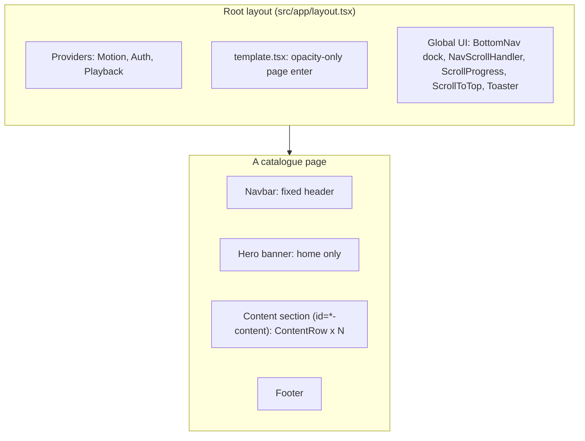
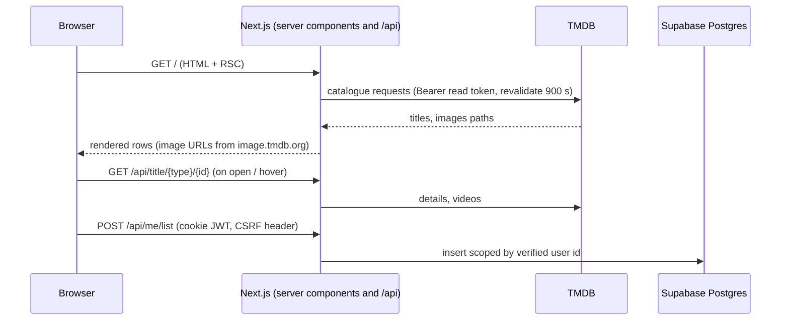
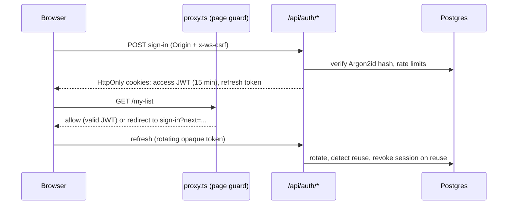
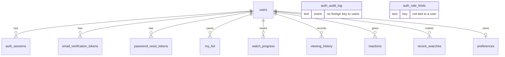
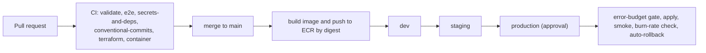

# British Streaming: Design and Architecture

How the product looks, how its UI is composed, and how the system behind it is built. Token values and code-level styling rules live in [STYLING.md](./STYLING.md); engineering rules live in [RULE.md](./RULE.md). Operational detail already documented elsewhere is linked, not repeated: [docs/architecture.md](./docs/architecture.md), [docs/auth.md](./docs/auth.md), [docs/animation.md](./docs/animation.md).

**Legend.** Sections are marked **Implemented** (present in the repository) or **Proposed** (not built). Proposed items are never described as existing.

## 1. Visual identity (Implemented)

- **Brand:** British Streaming. The wordmark is set in text with a blue-to-purple gradient (`from-ws-blue-light via-ws-purple-electric to-ws-lavender`), single source `src/lib/brand.ts`. There is no logo image asset in `public/`.
- **Feel:** premium, cinematic and dark. Artwork carries the colour; chrome stays quiet.
- **Palette:** Blue `#2563EB`, Purple `#7C3AED`, Grey `#64748B` on a near-black `#101116` background, with card `#1E1E2E` and elevated `#272735` surfaces. Full token table: [STYLING.md](./STYLING.md#colour-tokens).
- **Theme:** dark only (`<html class="dark">`, `colorScheme: "dark"`).
- **Typography:** Figtree for UI text, Geist Mono for code. Details: [STYLING.md](./STYLING.md#typography).
- **Principles:** minimal clutter; content first; every interactive element reachable by keyboard; motion that explains rather than decorates and that disappears for users who ask.

## 2. Layout architecture

- Each page renders its own `Navbar` and `Footer`; shared chrome that must persist (the dock, scroll handler, toasts) is mounted once in the root layout.
- The header is `position: fixed`. **No ancestor of the header may have a `transform`, `filter` or `perspective`**, because that would make it the header's containing block and the header would scroll away. This is why the route entrance in `globals.css` animates opacity only.
- Page content sits below `pt-28` (header clearance). `html { scroll-padding-top }` is the single source of the offset used by anchor jumps and the navigation scroll.

## 3. Core components (Implemented)

| Component | Where | Notes |
|---|---|---|
| **Sticky navigation** | `components/layout/navbar.tsx`, `mobile-nav.tsx`, `nav-link.tsx` | Fixed header, solid with a blue-purple underline once scrolled; links animate an active pill plus a purple hover underline. The mobile menu is a left sheet below `lg`. |
| **Navigation scroll** | `lib/nav-scroll.ts`, `lib/nav-targets.ts`, `layout/nav-scroll-handler.tsx` | A click on a nav link arms a one-shot request; the destination scrolls to its `*-content` section. Back/forward and refresh never trigger it. Reduced motion jumps instantly. |
| **Floating dock** | `ui/floating-dock.tsx`, `layout/bottom-nav.tsx` | Six destinations. Always visible below `lg`; on desktop it appears after scrolling 480px. Magnification only with a fine pointer and no reduced motion. Hidden on auth screens. |
| **Cinematic hero** | `hero/hero-banner.tsx` | Rotating featured titles, progress bar, play and More Info, trailer when available, swipe and arrow keys, pause control, scroll-linked parallax. |
| **Responsive media carousel** | `content/content-row.tsx`, `ui/carousel.tsx` | Embla through Animate UI. See [carousel behaviour](#carousel-behaviour). |
| **Media card** | `content/media-card.tsx`, `media-artwork.tsx` | 16:9 landscape (or 2:3 portrait for Top 10), "Recently Added" badge, progress bar for Continue Watching. |
| **Interactive media preview** | `content/movie-hover-preview.tsx` | Portal-rendered expanded card with art or muted trailer, actions, metadata and genres. |
| **Popover overlay positioning** | `previewGeometry()` in `movie-hover-preview.tsx` | Clamps to the viewport and flips inward at edges. Custom code, not Floating UI. |
| **Movie details modal** | `title/title-details-modal.tsx` | Centred dialog (max 900px) on `sm+`, bottom sheet below. Both have a 44px Close button. |
| **Video player** | `playback-provider.tsx`, `content/hover-preview.tsx` | YouTube trailer embeds only (`youtube-nocookie`). No full-length playback. |
| **Infinite Moving Cards** | `ui/infinite-moving-cards.tsx`, `content/infinite-media-gallery.tsx`, `popular-gb.tsx`, `picks-strip.tsx` | Generic structured-item marquee (adapted from Aceternity). See [marquee behaviour](#marquee-behaviour). |
| **Hero Parallax** | `ui/hero-parallax.tsx`, `content/featured-showcase.tsx` | Two-row feature band built from catalogue titles. Static grid below `md` and under reduced motion. |
| **Wavy Background** | `ui/wavy-background.tsx` | Canvas waves behind auth cards and the 404 screen; pauses off-screen or hidden; one static frame under reduced motion. |
| **Card Hover Effect** | `ui/card-hover-effect.tsx` | Shared sliding highlight on the language index grid; follows hover and keyboard focus. |
| **Authentication cards** | `account/auth-shell.tsx`, `fields.tsx`, `ui/shine-border.tsx`, `ui/interactive-hover-button.tsx` | One Shine Border instance per page, `InteractiveHoverButton` for submit, staggered form entrance. |
| **Footer** | `layout/footer.tsx` | Support text, Privacy, Terms & Conditions, Accessibility, copyright line. |
| **Animated 404** | `app/not-found.tsx`, `components/errors/*` | `ErrorScreen` with a static gradient always present and an optional wavy canvas, enabled only on capable devices. |

### Carousel behaviour

- Cards per view: `2 / 3 / 4 / 5 / 6 / 7` at `<480 / 480 / 768 / 1024 / 1280 / 1920` px; Top 10 rows run one step wider.
- Embla options: `align: "start"`, `slidesToScroll: "auto"`, `containScroll: "trimSnaps"`, `duration: 28`.
- Gutter `px-4 sm:px-[58px]`. A zero-content end spacer carries the right gutter, because padding on an overflowing flex container collapses and would clip the last card.
- The scroll viewport clips on the X axis only (`overflow-x: clip`), so previews and focus rings can extend vertically.
- Arrows are edge-height buttons visible on row hover or keyboard focus, hidden when they cannot scroll and hidden on touch (swipe is the primary input).
- Only the first home row autoplays (opt-in), with a visible pause control; it stops on hover, focus, touch, hidden tab, off-screen and reduced motion.

### Marquee behaviour

- The looping second copy is rendered by React, `aria-hidden`, and its cards are removed from the tab order; each title is announced and focusable once.
- Pauses on hover, on focus within, on the pause button, and while a hover preview is open (a `MutationObserver` watches for the portal element).
- With reduced motion, or with fewer than three items, nothing moves and the strip is a normal horizontally scrollable row.
- Pause is applied with an inline `animation-play-state`, because a utility class loses to the `animation` shorthand in stylesheet order.

## 4. Responsive design (Implemented)

- **Mobile-first.** Base styles target phones; `sm`, `md`, `lg`, `xl` (Tailwind defaults) and two arbitrary breakpoints (`min-[480px]`, `min-[1920px]`) add density. Container queries are not used by application code (only inside shadcn `Card`/`Field`).
- **Small phone (<480px):** 2-up rows, compact header (logo shrinks, bell hidden below 360px), dock permanently at the bottom, bottom-sheet details.
- **Phone/large phone (480-767px):** 3-up rows; hero buttons and metadata reflow.
- **Tablet (768-1023px):** 4-up rows; hamburger menu plus dock; larger details dialog; hover only if the device has a fine pointer (`(hover: hover) and (pointer: fine)`).
- **Laptop (1024-1279px):** inline nav (without "Browse by language" until `xl`), 5-up rows, hover previews.
- **Desktop and ultrawide (1280px+):** 6 and 7-up rows, full nav, dock after scroll.
- **Foldables:** no dedicated fold-posture handling exists. Layout depends on viewport width only, so inner and outer displays each get the matching breakpoint. Treat posture-aware layouts as **Proposed**.
- **Orientation:** portrait and landscape are handled by width breakpoints and `dvh`/`env(safe-area-inset-*)` units; there is no orientation-specific code.
- **Safe areas:** `viewport-fit=cover`; header, dock, auth shell and scroll padding add `env(safe-area-inset-*)`.

## 5. Animation architecture (Implemented)

Authoritative detail: [docs/animation.md](./docs/animation.md) and [STYLING.md](./STYLING.md#animation-tokens).

| Concern | Approach |
|---|---|
| Library split | `motion/react` for bespoke animation; Animate UI primitives for dialog, menu, tooltip, tabs, accordion, carousel. Imported only from subpaths. |
| Global config | `MotionProvider` sets `reducedMotion="user"` for both libraries. |
| Capability tiers | `none` (reduced motion), `lite` (weak device or data-saver), `full`, resolved in `lib/scroll-motion.ts`. |
| Scroll-triggered | `useScroll`/`useInView` (observer and rAF based) for reveals, parallax and progress. No hand-written scroll listeners for effects. |
| Hover previews | 400ms open delay, 120ms close grace so the pointer can cross into the portal; trailer starts after 600ms; spring scale-out from the card's own rect. |
| Modals | Dialog and sheet transitions from Animate UI; focus returns to the opening card on close. |
| Carousels | Embla settle shaped by `duration: 28`; staggered fade-in capped at six cards. |
| Route change | CSS opacity-only `.page-enter` (no transform; see layout rules). |
| Performance | Transform and opacity only; canvas at half resolution; off-screen and hidden-tab pausing; one hover preview at a time. |
| Reduced motion | Reveals become visible immediately; marquee and autoplay stop; parallax becomes a grid; canvas draws one frame; nav scroll jumps. |

## 6. System architecture

### 6.1 Frontend (Implemented)

Next.js App Router, React Server Components by default with client components where state, effects or browser APIs are needed (carousels, previews, dock, auth forms). Catalogue pages are server components that fetch from TMDB with revalidation and pass plain data into client components. Functions cannot cross that boundary, so server pages hand props only (see the `picks-strip.tsx` wrapper for the pattern).

Client state is held in providers (`auth-provider`, `playback-provider`, `motion-provider`) and hooks (`use-my-list`, `use-watch-progress`, `use-active-preview`, ...).

### 6.2 Backend and API data flow (Implemented)

- Catalogue helpers live in `src/lib/tmdb/`; all TMDB calls are server-only (`import "server-only"`), so the read token never reaches the browser.
- User-state routes (`/api/me/*`) require a valid session and scope every query by the verified user id.
- Trailer keys are fetched lazily and cached per title, so repeated hovers do not repeat requests.

### 6.3 Authentication (Implemented)

Summarised from [docs/auth.md](./docs/auth.md), which is authoritative.

The page guard is UX only; every API re-checks the live session row, so sign-out and password reset take effect immediately.

### 6.4 Media delivery (Implemented, limited)

- **Artwork:** TMDB image CDN, referenced by URL and optimised through `next/image`.
- **Video:** YouTube trailers in a chromeless `youtube-nocookie` iframe, muted by default, created only after a card wins the single active-preview slot.
- **Proposed:** hosting licensed full-length media, adaptive streaming, DRM and player QoE telemetry are **not** implemented.

### 6.5 Database relationships (Implemented)

From `supabase/migrations/`: `users` is the root; sessions, verification and reset tokens, audit rows and all user-state tables reference it.

`auth_rate_limits` and `auth_audit_log` are standalone (no foreign key to `users`). The earlier `profiles` table is dropped by the custom-auth migration. Relationships were read from the migrations; columns are abbreviated, so consult the SQL for the full schema.

### 6.6 Container deployment (Implemented, not yet executed)

Multi-stage Dockerfile (Node 22 Alpine; deps, build, runtime), non-root user `10001`, `tini` as init, health check on `/api/health`, `/api/ready` for readiness. Docker Compose adds Prometheus, Alertmanager, Grafana, Loki, Promtail and an OpenTelemetry Collector. Terraform provisions AWS (ECS Fargate, ALB, ECR with immutable tags, network, monitoring, storage; RDS behind `enable_database`).

### 6.7 CI/CD (Implemented, not yet executed end to end)

Additional workflows: CodeQL, Terraform plan/apply, Release (release-please), Reliability report. Dependabot and `CODEOWNERS` are configured.

### 6.8 Monitoring and observability

| Capability | Status |
|---|---|
| `/api/health`, `/api/ready`, `/api/metrics` (bearer-token protected), structured JSON logs with request IDs | Implemented |
| Web Vitals and player telemetry endpoints | Implemented (`/api/telemetry`); the player emits no QoE events yet |
| SLO source of truth `slo/slos.json`, generated Prometheus burn-rate rules, Grafana dashboards, Alertmanager | Implemented |
| Distributed tracing (OTLP spans from the app) | **Proposed:** collector configured, app instrumentation missing |

## 7. Existing architecture versus proposed improvements

| Area | Existing | Proposed (not built) |
|---|---|---|
| Playback | YouTube trailers | Licensed full-length streaming, adaptive bitrate, captions from a real player |
| Auth | Custom JWT, Argon2id, rotation | MFA, social login, EdDSA with `kid` rotation |
| Layout | Width breakpoints | Fold-posture-aware layouts |
| Observability | Metrics, logs, dashboards | App-emitted OTLP traces, player QoE |
| Legal pages | Placeholders | Counsel-reviewed Terms and Privacy |

Anything in the right-hand column must not be documented elsewhere as available.

## 8. Maintenance

Update this file when a component, route, data flow or deployment step changes. Keep component paths accurate; a stale path here is a bug.
