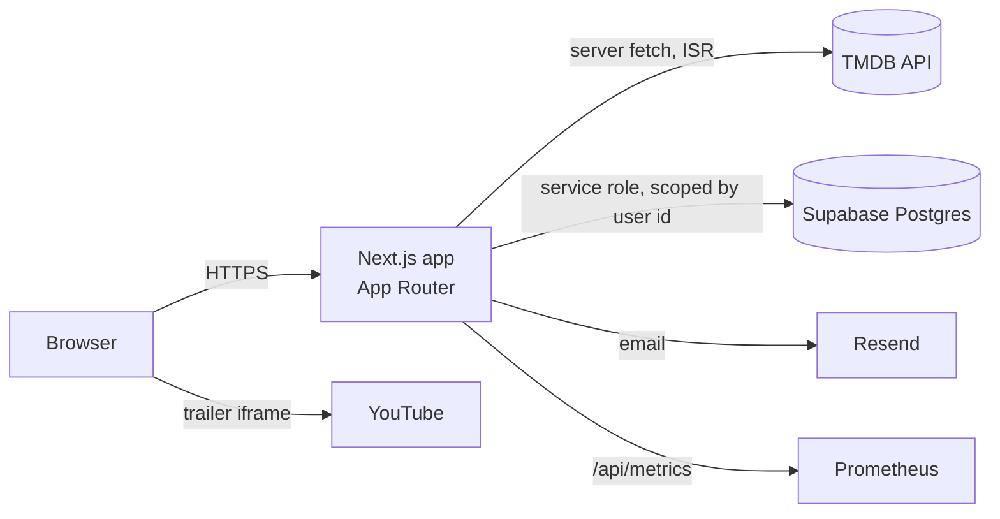

# British Streaming

A cinematic, responsive streaming-catalogue web application built with Next.js. It presents films and series from [TMDB](https://www.themoviedb.org/) in Netflix-style carousels with hover previews, details dialogs, a personal list, viewing progress and a custom JWT authentication system.

> **Scope note.** The catalogue, artwork and metadata come from TMDB. In-app video is **YouTube trailer playback** (embedded, muted previews and a trailer player). The project does **not** host or stream full-length films or episodes. See [Known limitations](#known-limitations).

> **Naming note.** The product name is *British Streaming*. The npm package name in `package.json` is still `netchannel` (a legacy name) and some infrastructure identifiers (JWT issuer, service and Terraform names) are still `worldstreaming`. These are deliberate and unchanged; see [RULE.md](./RULE.md#6-security).

## Documentation map

| Document | Purpose |
|---|---|
| [README.md](./README.md) | This file: overview, setup, routes, troubleshooting |
| [DESIGN.md](./DESIGN.md) | UI/UX and system architecture |
| [STYLING.md](./STYLING.md) | Design tokens, typography, components, animation tokens |
| [RULE.md](./RULE.md) | Engineering rules for developers and AI coding assistants |
| [LICENSE.md](./LICENSE.md) | Licensing **status** (undecided) and third-party licence notes |
| [COPYRIGHT.md](./COPYRIGHT.md) | Copyright, attribution and content-rights notes |

Deeper topic guides that already exist in [`docs/`](./docs): [setup](./docs/setup.md), [architecture](./docs/architecture.md), [auth](./docs/auth.md), [animation](./docs/animation.md), [scroll animations](./docs/scroll-animations.md) and the [runbooks](./docs/runbooks) (rollback, incident response, error-budget burn, disaster recovery).

## Features

Everything below is implemented in the repository today.

- **Cinematic home page** with an auto-advancing hero banner (pausable, swipe/keyboard aware), trending and curated rows, a "Featured" parallax band and an "Editor's picks" marquee.
- **Responsive carousels** (Embla via Animate UI): 2 to 7 cards per view across breakpoints, snap paging, touch swipe and mouse drag, arrow buttons and keyboard navigation, and no clipping of the last card.
- **Popular Films / Popular Series in GB** continuous-motion strips that pause on hover, focus and while a preview is open, with a pause button and a static, scrollable reduced-motion fallback.
- **Hover previews** rendered in a body-level portal (never clipped by a carousel), edge-aware positioning, one active preview at a time, and a muted trailer when one exists. Tap-to-open details on touch devices.
- **Title details dialog** (bottom sheet on phones) with metadata, cast, similar titles and season/episode lists for series.
- **Video**: YouTube trailer previews and trailer playback only.
- **JWT authentication**: register, email verification, sign in, remember me, sign out (this device or all), forgot/reset password, session management. See [docs/auth.md](./docs/auth.md).
- **My List, Continue Watching, watch history and reactions**, stored per user in Postgres (Supabase).
- **Search** with recent searches, and **browse by language**.
- **Navigation**: fixed header, mobile menu, floating dock (always visible below `lg`, appears after scrolling on desktop), and click-to-scroll to the destination's content.
- **Authentication screens** with a Shine Border card, Interactive Hover Button and a canvas "Wavy Background".
- **Animated 404 / error screens**, legal pages (Terms & Conditions draft, Accessibility statement) and a footer with legal links.
- **Responsive layouts** for phone, tablet and desktop, with safe-area support.
- **Accessibility work**: keyboard navigation, visible focus, reduced-motion support, an axe test suite. The target is WCAG 2.2 AA; conformance has **not** been formally verified. See [STYLING.md](./STYLING.md#accessibility).
- **Operations**: health/readiness endpoints, Prometheus metrics, structured logs, Web-Vitals and telemetry endpoints, SLO tooling.

## Technology stack

Versions are the ranges declared in [`package.json`](./package.json).

| Area | Technology |
|---|---|
| Framework | [Next.js](https://nextjs.org) 16.3.4 (App Router, `output: "standalone"`), [React](https://react.dev) 19.2.8 |
| Language | TypeScript 5 |
| Styling | Tailwind CSS 4, `tw-animate-css`, `class-variance-authority`, shadcn/ui (style `base-nova`) on Base UI and Radix UI |
| Animation | [Motion](https://motion.dev) (`motion/react`), [Animate UI](https://animate-ui.com) primitives, Embla Carousel |
| UI sources copied in | [Aceternity UI](https://ui.aceternity.com) (wavy background, hero parallax, card hover effect, infinite moving cards, floating dock) and [Magic UI](https://magicui.design) (shine border, interactive hover button), adapted under `src/components/ui/` |
| Icons | [Lucide React](https://lucide.dev) |
| Auth | Custom JWT with `jose` (HS256) and Argon2id (`@node-rs/argon2`), Zod validation |
| Data | TMDB API (catalogue), Supabase Postgres (user data) via `@supabase/supabase-js` |
| Email | Resend (optional; links are logged in development) |
| Testing | Playwright, `@axe-core/playwright`, Node's built-in test runner |
| Containers | Docker (multi-stage, non-root), Docker Compose with Prometheus, Alertmanager, Grafana, Loki, Promtail and an OpenTelemetry Collector |
| Infrastructure | Terraform (AWS: ECS Fargate, ALB, ECR; modules `network`, `ecs-service`, `monitoring`, `storage`, `database`, `stack`) |
| CI/CD | GitHub Actions (CI, Terraform, CodeQL, Deploy, Release, Reliability report), Dependabot, release-please, commitlint |

## Architecture overview



More detail and diagrams are in [DESIGN.md](./DESIGN.md#6-system-architecture).

## Getting started

### Prerequisites

- **Node.js 22** (the Docker image uses `22.12.0`; CI uses Node 22) and npm.
- A **TMDB v4 read access token** (free) for catalogue data.
- A **Supabase project** for accounts and user data (not required for the in-memory test mode described below).
- Optional: Docker (Compose) for the full local stack, Terraform and AWS credentials for deployment.

### Install

```bash
npm ci          # or: npm install
```

### Configure environment

```bash
cp .env.example .env.local
```

Fill in the values. Names (see [`.env.example`](./.env.example) for comments and defaults):

| Group | Variables |
|---|---|
| App | `NEXT_PUBLIC_APP_URL`, `NEXT_PUBLIC_APP_NAME`, `APP_URL` (runtime public origin, used for CSRF and email links) |
| TMDB | `TMDB_API_BASE_URL`, `TMDB_API_READ_TOKEN`, `TMDB_IMAGE_BASE_URL`, `TMDB_REGION`, `TMDB_LANGUAGE` |
| Supabase | `NEXT_PUBLIC_SUPABASE_URL`, `NEXT_PUBLIC_SUPABASE_PUBLISHABLE_KEY`, `SUPABASE_SECRET_KEY` |
| Auth | `AUTH_JWT_SECRET` (required in production, `openssl rand -base64 48`), `AUTH_JWT_ISSUER`, `AUTH_JWT_AUDIENCE`, `AUTH_ACCESS_TTL_SECONDS`, `AUTH_REFRESH_TTL_SECONDS`, `AUTH_REMEMBER_TTL_SECONDS`, `AUTH_ABSOLUTE_TTL_SECONDS`, `AUTH_RESET_TTL_SECONDS`, `AUTH_REQUIRE_VERIFIED_EMAIL`, `AUTH_TRUST_PROXY`, `AUTH_STORE` |
| Email | `RESEND_API_KEY`, `MAIL_FROM` |
| Operations | `APP_ENV`, `APP_VERSION`, `SERVICE_NAME`, `METRICS_TOKEN`, `OPS_DASHBOARD_ENABLED`, `PROMETHEUS_URL`, `PROMETHEUS_TOKEN`, `GRAFANA_ADMIN_PASSWORD` |
| Optional | `GEOAPIFY_API_KEY` (address autocomplete) |

Never commit real secrets. `.env`, `.env.local` and similar files hold secrets and must stay out of version control.

### Database

Apply the migrations in [`supabase/migrations`](./supabase/migrations) (`supabase db push`, or paste them into the Supabase SQL editor). **The custom-auth migration deletes existing user-state rows** that belonged to Supabase-Auth users; read the warning in [docs/auth.md](./docs/auth.md) before running it on a database with data.

### Run locally

```bash
npm run dev            # http://localhost:3000
```

Full stack with observability (app :3000, Grafana :3001, Prometheus :9090, Alertmanager :9093):

```bash
docker compose up --build
```

### Production build

```bash
npm run build
npm run start:standalone     # serves the standalone output (what the Docker image runs)
```

`output: "standalone"` is enabled, so `next start` is not supported; use `start:standalone` (or `node .next/standalone/server.js` after copying `.next/static` and `public`, which the script does).

> Do not run `npm run build` while `npm run dev` is running in the same folder: the build clears `.next` and the dev server will start returning 500s until restarted.

### Scripts

| Command | What it does |
|---|---|
| `npm run dev` | Next.js dev server |
| `npm run build` | Production build |
| `npm run start:standalone` | Serve the standalone production build |
| `npm run lint` | ESLint |
| `npm run typecheck` | `tsc --noEmit` |
| `npm run test:e2e` | Playwright suite (desktop Chrome, iPhone, Android, iPad profiles plus API projects) |
| `npm run test:ops` | SLO maths and config checks (no Docker needed) |
| `npm run test:motion` | Scroll-motion unit tests |
| `npm run slo:rules` / `slo:rules:check` | Generate / verify Prometheus SLO rules from `slo/slos.json` |

### Testing

```bash
npm run build
npm run test:e2e
```

The e2e config serves the production build against an in-memory auth store (`AUTH_STORE=memory`, `AUTH_UNSAFE_TEST_MODE=1`, accepted only when `APP_URL` is loopback). To run against an already-running server instead, set `E2E_BASE_URL`, for example `E2E_BASE_URL=http://localhost:3000 npx playwright test tests/e2e/media-gallery.spec.ts --project=desktop-chrome`. Hero tests skip when no TMDB token is configured. The Supabase store and real email delivery are **not** covered by automated tests ([docs/auth.md](./docs/auth.md#tests)).

## Application routes

| Page | Route | Access |
|---|---|---|
| Home | `/` | Public |
| Series | `/series` | Public |
| Films | `/films` | Public |
| New & Popular | `/new-popular` | Public |
| My List | `/my-list` | Signed-in (redirects to sign-in) |
| Browse by Language | `/browse/languages` | Public |
| Sign In | `/account/sign-in` | Guests (signed-in users are redirected) |
| Register | `/account/register` | Guests |
| Forgot Password | `/account/forgot-password` | Guests |
| Reset Password | `/account/reset-password` | Public (token link) |
| Verify Email | `/account/verify-email` | Public (token link) |
| Terms & Conditions | `/legal/terms-and-conditions` | Public (**draft with placeholders, needs legal review**) |
| Accessibility | `/accessibility` | Public (statement with placeholders) |
| Title details | `/title/[type]/[id]` | Public |
| Watch history | `/watch-history` | Signed-in |
| Profile, Settings | `/account/profile`, `/account/settings` | Signed-in |
| Privacy | `/privacy` | Public (**placeholder text**) |
| Terms (legacy) | `/terms` | Redirects to `/legal/terms-and-conditions` |
| Browse (legacy) | `/browse` | Members-only; redirects to `/` |
| Account index | `/account` | Redirects to `/account/profile` |
| Ops dashboard | `/ops` | Disabled unless `OPS_DASHBOARD_ENABLED` is set |
| Animation lab | `/dev/scroll-lab` | Dev builds, or `ANIMATION_LAB_ENABLED=true` |

API routes live under `src/app/api/` (auth, my-list, progress, history, reactions, search, titles, health, ready, metrics, telemetry, places).

Not implemented (so not listed above): multi-factor authentication, social login, account deletion and email-change flows, full-length video playback.

## Deployment

The reference deployment is AWS (ECS Fargate behind an ALB, `eu-west-2`) provisioned with Terraform and deployed by GitHub Actions through dev, staging and production with a production approval gate. Setup steps are in [docs/setup.md](./docs/setup.md) and the design in [docs/architecture.md](./docs/architecture.md).

> The Dockerfile, Compose file, Terraform and workflows were written but, per [docs/architecture.md](./docs/architecture.md), **not executed** in the environment where they were authored; CI validates them on first run. Treat the first deployment as unverified.

Rollback: [docs/runbooks/rollback.md](./docs/runbooks/rollback.md).

## Security considerations

- Auth is custom: 15-minute HS256 access JWT plus a rotating opaque refresh token, both in HttpOnly cookies; passwords are hashed with Argon2id; refresh-token reuse revokes the session; rate limiting, CSRF checks and open-redirect protection are in place. Full design: [docs/auth.md](./docs/auth.md).
- Page guards in `src/proxy.ts` are UX only; every API route re-validates the session server-side.
- The server uses the Supabase service-role key and scopes every query by the verified user id. Row-level security is enabled with no policies, so browsers cannot read tables directly.
- Never put tokens in `localStorage`/`sessionStorage`; never log secrets; never set `AUTH_STORE=memory` outside local tests.
- Known gaps: HS256 shared secret (rotation signs everyone out), no MFA, rate-limit IP logic assumes one trusted proxy.

## Troubleshooting

| Symptom | Likely cause and fix |
|---|---|
| Catalogue empty, "temporarily unavailable" | `TMDB_API_READ_TOKEN` missing or invalid |
| Dev server returns 500 after a build | A production build cleared `.next`; stop and restart `npm run dev` |
| `next build` fails with "Specified module format (CommonJs)..." | `package.json` contains `"type": "commonjs"`; remove it (this is an ESM codebase) |
| `next start` warns about standalone output | Use `npm run start:standalone` |
| Sign-up shows success but no email | No `RESEND_API_KEY`; in development the link is printed in the server log |
| E2E tests time out on a slow machine | Run with `--workers=1 --timeout=120000`, and against a production build rather than `next dev` |
| Registration or sign-in returns 500 locally | Supabase env vars or migrations missing; or use the in-memory test mode only for tests |

## Contributing

1. Read [RULE.md](./RULE.md) (it applies to humans and AI assistants alike) and `AGENTS.md`.
2. Create a branch; keep changes focused.
3. Use [Conventional Commits](https://www.conventionalcommits.org/) (enforced by commitlint and by the `conventional-commits` CI job).
4. Run `npm run lint`, `npm run typecheck` and the relevant tests before opening a pull request.
5. Update the docs listed above when behaviour, tokens, architecture or dependencies change.

## Known limitations

- Trailers only; no full-length playback. Video quality-of-experience telemetry (`start/buffer/error`) is accepted by `/api/telemetry` but the player does not emit it.
- OpenTelemetry Collector is configured, but the app does not yet emit OTLP traces.
- `/privacy` is placeholder text and `/legal/terms-and-conditions` is a draft; both need legal review before real users.
- No licence has been chosen; see [LICENSE.md](./LICENSE.md).

## Licence and copyright

Licensing is **undecided** and ownership details must be confirmed by the project owner. See [LICENSE.md](./LICENSE.md) and [COPYRIGHT.md](./COPYRIGHT.md). Until a licence is chosen, no permission to use, copy or distribute this code is granted by this repository.
